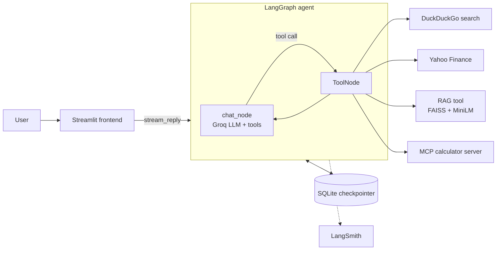

# LangGraph Agentic Chatbot

A tool-calling AI agent built with **LangGraph**: it chats, searches the web, fetches live stock prices,
answers questions over your PDFs (RAG with page citations) and calls tools from an **MCP server**,
with persistent multi-session memory, real-time streaming and **LangSmith** tracing.


## Features

| Feature | How it works |
|---|---|
| **Tool-calling agent** | A LangGraph `StateGraph` loops between the LLM and a `ToolNode`; `tools_condition` routes to tools or ends the turn |
| **Chat with your PDF (RAG)** | Upload a PDF → split into chunks → embedded locally with `all-MiniLM-L6-v2` → stored in a **FAISS** index per chat. Answers cite page numbers |
| **MCP tools** | A calculator runs as a separate **Model Context Protocol** server (stdio subprocess); its tools load into the agent automatically |
| **Web search & live data** | DuckDuckGo search and Yahoo Finance stock prices as LangChain tools |
| **Persistent memory** | Async **SQLite checkpointer** saves every conversation; reopen any past chat from the sidebar |
| **Auto chat titles** | A separate LLM call names each new chat |
| **Streaming UI** | Tokens stream live, and the UI shows which tool the agent is using |
| **Observability** | Every run, LLM call and tool call is traced in **LangSmith**, grouped by conversation thread |

## Architecture



**Async design:** Streamlit is synchronous, so the backend runs one asyncio event loop in a background
thread. The graph, the checkpointer and the MCP client all run on that loop; the frontend calls them
through small sync wrappers, and streamed tokens are passed back through a queue.

## Project structure

```
chatbot_backend.py        # LangGraph agent, tools, RAG, MCP client, checkpointer
streamlit_frontend.py     # Chat UI: streaming, sidebar history, PDF upload
calculator_mcp_server.py  # Standalone MCP tool server (FastMCP, stdio)
sample_policy.pdf         # Small PDF to try the RAG feature
```

## Run locally

```bash
git clone https://github.com/msdianprince-7/langgraph-agentic-chatbot.git
cd langgraph-agentic-chatbot

python -m venv venv
venv\Scripts\activate          # Windows
# source venv/bin/activate     # macOS / Linux

pip install -r requirements.txt
cp .env.example .env           # then add your GROQ_API_KEY

streamlit run streamlit_frontend.py
```

Open http://localhost:8501. The first start takes a minute or two while the embedding model downloads and loads.

## Try it

- *"What's the latest price of TSLA?"* → stock tool
- *"What happened in AI news this week?"* → web search
- *"What is 1234 multiplied by 56?"* → MCP calculator
- Upload `sample_policy.pdf`, then ask *"What does this policy say?"* → RAG with page citations

## Tech stack

Python · LangGraph · LangChain · Groq (`openai/gpt-oss-20b`) · FAISS · Sentence-Transformers ·
Model Context Protocol (MCP) · SQLite (aiosqlite) · Streamlit · LangSmith

## License

MIT
